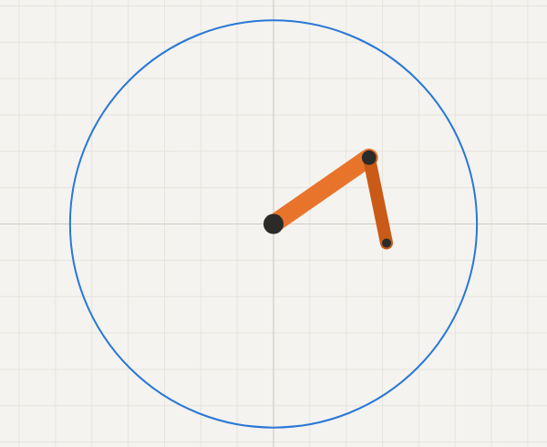

# Robot Arm Simulator

A 2-joint robot arm that runs in the browser. Move your mouse and the arm follows it, or drag the joint sliders to move it yourself.

**[Try it here](https://faran-saharan.github.io/robot-arm-simulator/)**



## Why I made it
I worked with industrial robots during my co-op at ATS as well as Camcor (division of Linamar), and I wanted to understand how a robot figures out what angles to put its joints at to reach a point.

## What it does
- **Follow the mouse:** the arm reaches for your mouse. The blue circle shows the furthest it can reach. Go outside it and the arm stretches as far as it can and the readout says "Out of reach".
- **Joint sliders:** they show the arm's current angles. Drag one to move the joints yourself and see where the tip ends up. Move the mouse over the grid to go back to following.
- **Link sliders:** change how long each part of the arm is, and the blue circle changes with it.
- **Flip elbow:** most points can be reached two ways, with the elbow bent either side. This switches between them.

## How it works
There are two directions to the math, both in `js/kinematics.js`:

- **Forward kinematics** (the joint sliders): you know the joint angles and work out where the tip is. This is just adding up the two links with sin and cos.
- **Inverse kinematics** (following the mouse): you know where you want the tip and work out the joint angles. The distance to the target tells you how much the elbow has to bend, then the shoulder points at the target with a correction for the bend.

## Run it yourself
Download the repo and open `index.html` in your browser. Nothing to install.

To run the tests (needs Node.js):

```
npm test
```
